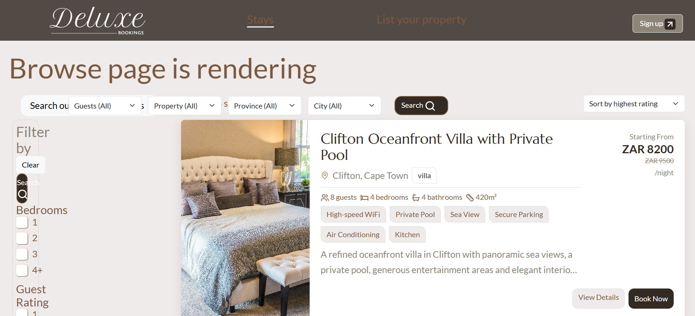
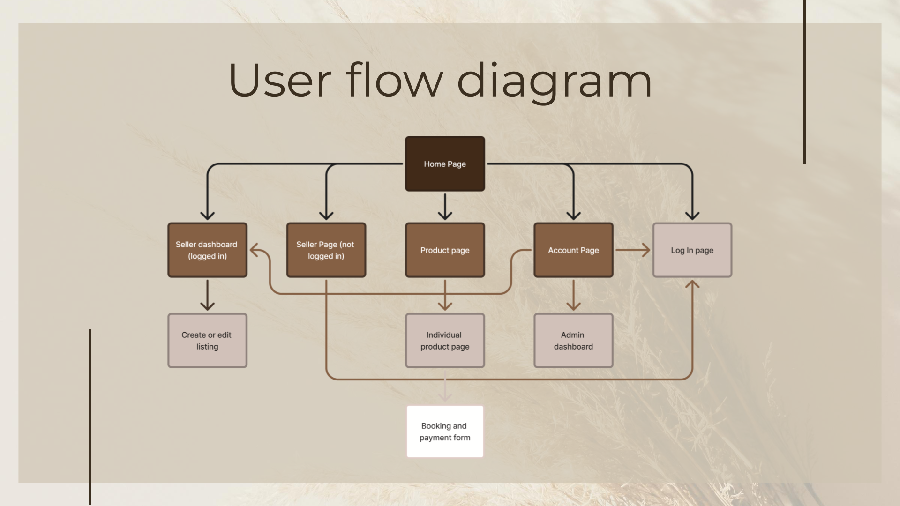
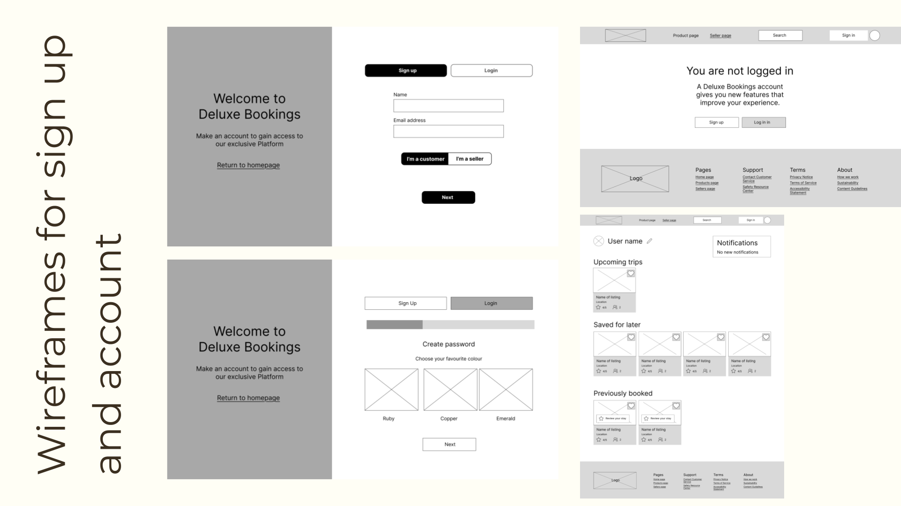
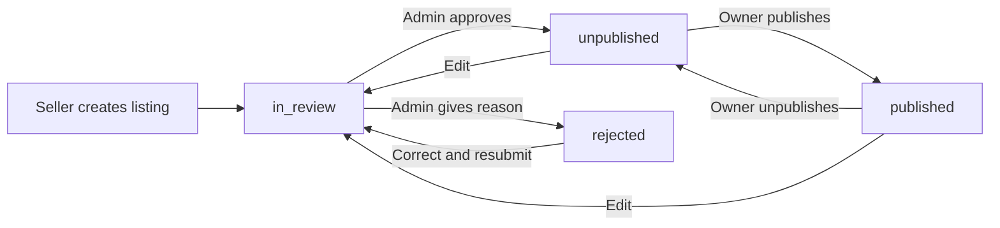

<p align="center">
  
</p>

# Deluxe Bookings

A MERN application for discovering luxury accommodation and managing property listings through seller submission, administrator review and publication.

**DV200 · Term 2 · Group project · Local academic prototype**

Built by [Kirsten Venter](https://github.com/KIRSTEN-23), [Khanyisile Manana](https://github.com/Khanyi20) and [Joelene du Toit](https://github.com/Joelene241161).

This portfolio focuses on **Kirsten's listings entity**: property data, listing CRUD, buyer/seller/admin listing views and the review-to-publication workflow. Authentication, bookings and reviews provide the wider team application context. The current portfolio iteration also includes later fixes to validation, feedback, routing and fluid layouts.

## Contents

- [About the Project](#about-the-project)
- [My Contribution and Collaboration](#my-contribution-and-collaboration)
- [Tech Stack and Justification](#tech-stack-and-justification)
- [Key Features](#key-features)
- [Process and Planning](#process-and-planning)
- [Running the Project](#running-the-project)
- [Project Structure](#project-structure)
- [Architecture and Data](#architecture-and-data)
- [Core Code: Listings CRUD API](#core-code-listings-crud-api)
- [Stylekit](#stylekit)
- [Validation](#validation)
- [Learning and Next Steps](#learning-and-next-steps)
- [Presentation](#presentation)
- [Contributing](#contributing)
- [License](#license)
- [Acknowledgements](#acknowledgements)
- [Contact](#contact)

## About the Project

Deluxe Bookings explores a luxury accommodation marketplace with three main journeys:

- **Travellers** browse published properties, inspect their details and submit a booking request.
- **Sellers** create and manage property listings.
- **Administrators** review submitted listings before sellers can publish them.

The central listings problem is keeping the same property information consistent across these journeys while controlling when it becomes public. A shared listing model and explicit review statuses connect the interfaces to the API.

This is a local assessment project. No deployment was involved, and the application does not process payments or send booking confirmation emails.

## My Contribution and Collaboration

| Contributor | Scope in this portfolio |
| --- | --- |
| [Kirsten Venter](https://github.com/KIRSTEN-23) | Listings entity: schema, listing CRUD, role-specific listing screens and approval/publication flow. |
| [Khanyisile Manana](https://github.com/Khanyi20) | Group collaborator on the shared application. |
| [Joelene du Toit](https://github.com/Joelene241161) | Group collaborator on the shared application. |

The portfolio presentation centres on the listings work, with authentication, bookings and reviews credited as shared team context.

The original presentation records merge conflicts, file-path problems, missing dependencies and communication as development challenges. Feature-based folders and shared API/component conventions help make these integration boundaries easier to follow.

## Tech Stack and Justification

| Technology | Why it fits this project |
| --- | --- |
| **MongoDB** | Stores property documents with nested location, image and review information. |
| **Mongoose** | Defines required fields, allowed values, references and validation around those documents. |
| **Node.js + Express** | Provides the custom API, with routes, middleware and controllers written in JavaScript. |
| **React** | Composes listing cards, forms and role-specific pages from reusable components. |
| **Vite** | Runs the frontend development server and produces its production build. |
| **React Router** | Maps public, seller and administrator URLs to their page compositions. |
| **Axios** | Connects the frontend to the API and provides a common place for request configuration and errors. |
| **React Bootstrap + CSS** | Supplies common controls, with application layout rules collected in a dedicated responsive stylesheet. |
| **bcrypt + JSON Web Tokens** | Supports the team's picture-password authentication and authenticated API access. |

The graphical password is a creative authentication exercise, not a production authentication scheme. Hashing protects the stored password representation, but the current picture choices provide only 96 possible combinations.

## Key Features

### Listings: the portfolio focus

| Journey | Current behaviour |
| --- | --- |
| Browse and read | Public catalogue and detail pages show published, unpaused properties. |
| Search and filter | Combines location, property type, guest capacity, bedrooms and amenities. Results can be sorted by price or newest. |
| Create | A seller completes a property form and submits the listing for review. |
| Save a draft | An unfinished form can be saved and resumed in the same browser, separately for each account. |
| Review | Administrators approve a submission or reject it with an explanation. |
| Publish | The owner publishes an approved, unpublished listing. Approval itself does not make it public. |
| Update | Changes to an approved or published property return it to review. A rejected property can be corrected and resubmitted. |
| Unpublish and delete | Sellers can remove a published listing from public results or permanently delete a listing after confirmation. |
| System feedback | Listing flows display loading, validation, success, failure and relevant next-step messages. |



*Historical screenshot from the group project. The current portfolio version includes subsequent interface refinements.*

### Wider team application

- Picture-based account registration and login, with customer/seller account choices.
- Account viewing, profile editing, logout and account deletion.
- Guest booking requests linked to a selected listing, with a server-calculated stay total and an initial pending status.
- Seller booking views scoped to the owner's listings.
- A review submission form. Reviews currently use a property-name field; aggregated listing ratings are not implemented.
- Seller onboarding with an illustrative earnings calculator.

The onboarding estimates are presentation content, not verified earnings or live marketplace analytics.

## Process and Planning

### Thought process

The listings solution follows three decisions:

1. **Use one property model.** Store location, photos, price, capacity, owner and status consistently instead of creating separate buyer and seller records.
2. **Separate the role views.** Travellers need discovery and detail, sellers need editing and publication actions, and administrators need a review queue.
3. **Treat publication as a workflow.** A saved listing is not automatically a public listing. The API checks both ownership and eligible status before publishing it.

### Planning evidence

The repository contains original planning, user-flow and wireframe assets. These show the initial direction rather than a claim that every planned feature was completed.





[View the original planning document](frontend/src/Assets/ReadMeimages/planning%20document.png) · [Browse all planning and screenshot assets](frontend/src/Assets/ReadMeimages)

### Implementation and iteration

The work connects schema design to API routes and then to React page compositions. Shared listing cards and detail components reduce duplication between role views.

A later portfolio audit identified integration problems such as broken route links, mismatched request fields, missing action handlers and silent failures. The refinement pass addressed these alongside status guards, account ownership, clearer feedback and fluid layouts. [Audit resolutions](docs/audit-resolution.md) and [responsive layout notes](docs/responsiveness.md) record that work and its verification limits.

## Running the Project

### Prerequisites

- Node.js 20.19+ within the 20.x release line, or 22.12+ (as required by the locked Vite version).
- npm.
- A MongoDB instance, either local or MongoDB Atlas.

Use fictional assessment data. There is no automatic database seed or administrator-creation command in this repository.

### Installation

```sh
git clone https://github.com/KIRSTEN-23/DeluxeBookings.git
cd DeluxeBookings
```

Install each application's locked dependencies:

```sh
cd backend
npm ci
```

In a second terminal, from the repository root:

```sh
cd frontend
npm ci
```

### Configuration

Create `backend/.env` if it does not already exist, and supply your own values:

```env
PORT=5001
MONGO_URI=mongodb://127.0.0.1:27017/deluxe_bookings
JWT_SECRET=replace_with_a_long_random_secret
```

For Atlas, use your own connection string and permitted network access. Do not commit connection strings, secrets or real account details.

The frontend defaults to `http://localhost:5001/api`. To override it, create or update `frontend/.env`:

```env
VITE_API_URL=http://localhost:5001/api
```

Restart the frontend development server after changing its environment configuration.

### Start the application

From `backend/`:

```sh
npm run dev
```

From `frontend/`, in a separate terminal:

```sh
npm run dev
```

Open [the local frontend](http://localhost:5173). Vite may choose another port if 5173 is occupied. [The API root](http://localhost:5001/) returns a running-status message; it is not a full database-health endpoint.

Register a fictional customer or seller through the application. Administrator access is assigned separately in the assessment database to an existing account with `userRole: "A"`; public registration cannot grant this role. Use your own local test database and sign in again after changing an account's role.

## Project Structure

```text
backend/
├── _config/                  # Database connection and shared constants
├── features/
│   ├── auth/                 # Registration and login
│   ├── bookings/             # Booking persistence and seller booking views
│   ├── listings/             # Schema, routes and role-specific controllers
│   ├── reviews/              # Review submissions
│   └── users/                # Account schema and profile operations
├── middleware/               # Token and role checks
├── tests/                    # Backend regression checks
├── app.js                    # Express middleware and route mounting
└── server.js                 # Database connection and server startup
frontend/
├── src/
│   ├── api/                  # Axios configuration and feature API helpers
│   ├── components/           # Shared controls, listing elements and forms
│   ├── context/              # Authentication context
│   ├── pages/                # Public, account, listing and booking pages
│   ├── routes/               # Page routes and access wrappers
│   ├── styles/               # Feature styles and Responsiveness.css
│   ├── utils/                # Mapping, validation, feedback and local drafts
│   └── Assets/               # Application imagery and planning evidence
└── tests/                    # Frontend utility regression checks
docs/                         # Controller notes, audit and portfolio material
```

## Architecture and Data

A listing request follows this path:

```text
React page → API helper → Express route → middleware/controller → Mongoose → MongoDB
           ← JSON response ←                                         ← result
```

Public reads use publication filters. Seller/admin routes also authenticate the request and check the account's current database role. Seller operations use the authenticated account ID rather than trusting an owner ID supplied by the browser.

### Listing data

The `Listing` document includes:

- A `seller` reference to a `User`.
- Property title, description and property type.
- Nested `location` information and an `images` array.
- Nightly price, guest capacity, bedrooms, bathrooms, amenities and house rules.
- A status plus administrator review notes, reviewer and review time.

Bookings can reference a listing. Reviews are currently submitted using a property name, so they do not yet provide a reliable reference for calculating per-listing ratings.

### Listing lifecycle



`draft` exists in the status constants, but the current Save draft action stores an unfinished form in browser storage. It does not create a database listing with that status.

### Listings API examples

All paths below are relative to `http://localhost:5001` by default.

| Method | Endpoint | Purpose |
| --- | --- | --- |
| GET | `/api/listings/browse` | Published catalogue. |
| GET | `/api/listings/browse/:id` | Published property details. |
| GET | `/api/listings/search` | Combined public search filters. |
| GET / POST | `/api/listings/seller/my-listings` | Read the owner's listings or create a submission. |
| GET / PUT / DELETE | `/api/listings/seller/my-listings/:id` | Read, update or delete an owned listing. |
| PATCH | `/api/listings/seller/my-listings/:id/publish` | Publish an eligible listing. |
| PATCH | `/api/listings/seller/my-listings/:id/unpublish` | Unpublish a published listing. |
| PATCH | `/api/listings/seller/my-listings/:id/resubmit` | Return a rejected listing to review. |
| GET | `/api/listings/admin/review` | Review queue. |
| PATCH | `/api/listings/admin/review/:id/approve` | Approve a pending review. |
| PATCH | `/api/listings/admin/review/:id/reject` | Reject with explanatory notes. |

## Core Code: Listings CRUD API

Creating our own API was a core term outcome. The examples below connect **Create, Read, Update and Delete** to the seller listing routes. Editing uses Read to load the form and Update to save its changes.

Base URL: `http://localhost:5001/api/listings/seller/my-listings`.

These excerpts come from the current portfolio version of [`sellerListingController.js`](backend/features/listings/sellerListingController.js). The surrounding handlers catch errors. [`listingRoutes.js`](backend/features/listings/listingRoutes.js) applies token and seller-role middleware before dispatching requests. `sellerId` comes from `req.user.id`.

### Create

`POST /api/listings/seller/my-listings` · controller lines 42–48

```js
const listing = await Listing.create({
  ...pickListingFields(req.body),
  seller: sellerId,
  status: LISTING_STATUS.IN_REVIEW,
});

res.status(201).json(listing);
```

`pickListingFields` accepts only editable property fields. The server supplies the authenticated owner and initial `in_review` status, then returns the new listing with HTTP 201.

### Read

`GET /api/listings/seller/my-listings/:id` · controller lines 23–32

```js
const listing = await Listing.findOne({
  _id: req.params.id,
  seller: sellerId,
});

if (!listing) {
  return res.status(404).json({ message: "Listing not found." });
}

res.status(200).json(listing);
```

The query matches both the requested ID and the authenticated seller. This read populates the edit form. A missing or unowned record returns 404; a successful read returns 200.

### Update

`PUT /api/listings/seller/my-listings/:id` · controller lines 62–84

```js
const sellerId = req.user.id;
const existing = await Listing.findOne({ _id: req.params.id, seller: sellerId });
if (!existing) return res.status(404).json({ message: "Listing not found." });
const nextStatus = existing.status === LISTING_STATUS.REJECTED ? LISTING_STATUS.REJECTED : LISTING_STATUS.IN_REVIEW;

const listing = await Listing.findOneAndUpdate(
  {
    _id: req.params.id,
    seller: sellerId,
    status: existing.status,
  },
  { $set: { ...pickListingFields(req.body), status: nextStatus } },
  {
    new: true,
    runValidators: true,
  },
);

if (!listing) {
  return res.status(409).json({ message: "This listing changed while you were editing. Reload it and try again." });
}

res.status(200).json(listing);
```

The controller first loads the owned listing and calculates its next status. It then updates allowed fields, runs schema validators and requires the status to still match the one it read. An intervening status change returns 409. This guard does not detect every concurrent field edit. Approved or published listings return to review; rejected listings remain rejected until resubmission.

### Delete

`DELETE /api/listings/seller/my-listings/:id` · controller lines 164–178

```js
const listing = await Listing.findOneAndDelete({
  _id: req.params.id,

  seller: sellerId,
});

if (!listing) {
  return res.status(404).json({ message: "Listing not found." });
}

res.status(200).json({
  message: "Listing permanently deleted.",

  listingId: req.params.id,
});
```

The delete query includes ownership. A missing or unowned record returns 404. Success returns HTTP 200 with the deleted ID and a message the interface can display.

The shared data challenge is keeping the API in control of ownership, editable fields and publication status. The browser sends property details, while the server decides which account may act on the record and which status follows the action. The separate publish endpoint then allows an approved, unpublished listing to go public.

## Stylekit

The visual direction uses accommodation photography, warm neutrals and a dark brown interface palette.

| Role | Colour |
| --- | --- |
| Brand / primary | `#332A23` |
| Strong text | `#7B593F` |
| Secondary text | `#8C8578` |
| Accent / strong stroke | `#A48A56` |
| Page background | `#EFEBEA` |
| Surface | `#FFFFFF` |

Typography is defined in [`index.css`](frontend/src/index.css): Lato for body content, Marcellus for headings and Playfair Display for selected display/italic text.

Fluid behaviour is collected in [`Responsiveness.css`](frontend/src/styles/Responsiveness.css), using the agreed custom thresholds of **390px, 1440px and 1920px**. Flexible widths and wrapping handle intermediate sizes. Seller onboarding retains its desktop content composition at 1440px and above.

The shared [button system](docs/buttons.md) defines primary, secondary, tertiary and semantic actions, fill/outline appearances, optional icons and consistent interaction states.

## Validation

From `backend/`:

```sh
npm test
```

From `frontend/`:

```sh
npm test
npm run lint
npm run build
```

The current automated suites contain **15 backend and 8 frontend tests**. Backend database operations are mocked. These checks cover important booking, ownership, status, search, authentication and feedback rules, but do not replace a live database walkthrough or a full visual/accessibility review.

## Learning and Next Steps

### Learning aligned with the term

**Creating our own API:** The listings work connects HTTP routes, controllers, schema validation, role checks and JSON responses. A button in the interface is only the beginning; the server must also enforce ownership and valid data transitions.

**Creative authentication:** The team explored a picture-choice password rather than a conventional text-password interaction. Integrating listings with that flow demonstrates the distinction between authenticating an account and authorising what that account may do. bcrypt and JWT support the implementation, while the small picture-choice space remains a prototype limitation.

**Integration and feedback:** Frontend routes, request payloads and database fields must agree. Loading, success and failure feedback should describe the outcome that actually occurred, especially when a listing changes status or a booking request is saved.

### Roadmap

- [x] Connect the listings schema, custom API and role-specific interfaces.
- [x] Implement review, rejection feedback, publication and resubmission.
- [x] Refine route connections, ownership checks and system feedback.
- [x] Consolidate fluid responsive rules into a dedicated stylesheet.
- [ ] Finish the device, keyboard and accessibility walkthrough across all role views.
- [ ] Move inline property photos to dedicated storage and improve image delivery.
- [ ] Strengthen authentication before considering production use.
- [ ] Link reviews to listing IDs before implementing aggregated ratings.
- [ ] Extend live integration coverage for the full seller/admin lifecycle.

## Presentation

- [10-minute Canva portfolio presentation](https://canva.link/kggp8nfvz0thqff).
- [Original group presentation](https://docs.google.com/presentation/d/1VcBYSDnHgo7BGjqqqkDsqbiWnNSc8-G-iYqFT0hJzWM/edit).
- [10-minute portfolio presenter guide](docs/presentation/portfolio-talk.md), centred on the listings entity, with a local demo runbook and the CRUD API explanations.

The portfolio talk keeps the wider application introduction short and reserves three minutes for a live demonstration. A recording is not linked until one has been produced.

## Contributing

This is a student group project. For a proposed change, open an issue or work on a focused branch, describe the affected journey and run the relevant checks before opening a pull request. Keep credentials and real personal data out of commits.

## License

No software licence is declared in this repository. Application branding and third-party media remain subject to their owners' permissions and licences.

## Acknowledgements

Thank you to Khanyisile Manana and Joelene du Toit for their collaboration, and to the maintainers of the open-source tools used in the project.

The original DV200 group outline informed the presentation coverage. The README organisation loosely follows the [CLAW project reference](https://github.com/KIRSTEN-23/MERN_CLAW_NPO_Website), adapted to this local MERN project without a deployment section.

## Contact

For project feedback, [open a GitHub issue](https://github.com/KIRSTEN-23/DeluxeBookings/issues) or visit [Kirsten's GitHub profile](https://github.com/KIRSTEN-23).
